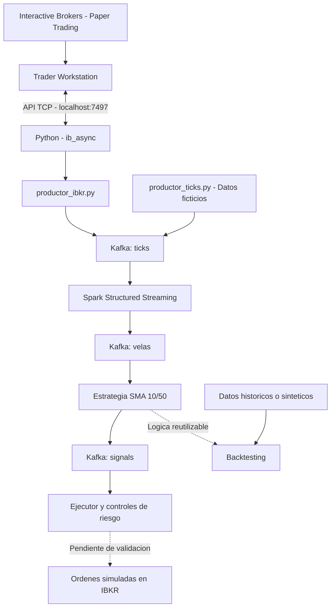

# Proyecto de Trading Algorítmico

**Proyecto escolar | Licenciatura en Inteligencia Artificial y Ciencia de Datos**

**Equipo:** 6 estudiantes
**Corte documentado:** 27 de noviembre de 2026
**Estado:** Bloque B aprobado y ciclo automático con señales controladas validado en TWS Paper. El ciclo integral con cotizaciones de mercado y órdenes Paper también quedó verificado. Restan las pruebas de recuperación del paso 20.

> **Aviso:** Este proyecto tiene fines exclusivamente educativos. El proyecto recibe cotizaciones de EURUSD y ejecuta órdenes exclusivamente en la cuenta Paper autorizada.

## 1. ¿Qué queremos construir?

Un sistema de trading algorítmico: programas que reciben precios de un activo financiero, los procesan y aplican reglas matemáticas para producir señales de compra o venta.

El profesor solicita:

1. Interactive Brokers (IBKR) en modo demo/paper como fuente de cotizaciones de FOREX, preferentemente EURUSD o GBPUSD.
2. Apache Kafka como medio para intercambiar eventos de precios.
3. Apache Spark Structured Streaming para convertir cotizaciones (ticks) en velas de un minuto.
4. Uno o varios algoritmos que lean ticks o velas y publiquen señales BUY/SELL.
5. Un programa ejecutor que revise los riesgos y envíe órdenes exclusivamente a la cuenta paper.
6. Opcional/deseable: backtesting, para evaluar una estrategia utilizando datos históricos.

El profesor también exige formatos comunes de eventos para que los algoritmos de un equipo puedan ejecutarse sobre la plataforma de otro.

### Elección del equipo

Desarrollar inicialmente una estrategia de medias móviles simples de 10 y 50 velas para EURUSD, adaptando el pseudocódigo del profesor de BTC/USDT al mercado FOREX.

---

## 2. Arquitectura del sistema



### 2.1. Responsabilidad de cada componente

| Componente | Responsabilidad |
|---|---|
| Interactive Brokers | Fuente de cotizaciones y destino previsto de órdenes simuladas. |
| Trader Workstation | Gestionar la sesión y proporcionar acceso a la API. |
| ib_async | Facilitar la comunicación entre Python y TWS. |
| Productor IBKR | Preparar cotizaciones para publicarlas en Kafka. |
| Productor ficticio | Generar datos controlados para pruebas. |
| Kafka | Transportar eventos entre componentes independientes. |
| Spark | Procesar cotizaciones y construir velas OHLC. |
| Estrategia SMA | Evaluar velas y generar señales BUY/SELL. |
| Ejecutor | Validar riesgos y autorizar o rechazar operaciones simuladas. |
| Backtesting | Evaluar la estrategia mediante datos históricos o sintéticos. |

### 2.2. Conceptos clave

- **API:** interfaz que permite la comunicación entre aplicaciones.
- **Socket TCP:** canal de comunicación entre procesos informáticos.
- **Tick:** mensaje que contiene una cotización.
- **BID:** precio disponible para vender la divisa base.
- **ASK:** precio disponible para comprar la divisa base.
- **Spread:** diferencia entre ASK y BID.
- **Tópico:** canal de Kafka que almacena mensajes de un determinado tipo.
- **Productor:** programa que publica mensajes.
- **Consumidor:** programa que recibe mensajes.
- **Streaming:** procesamiento de datos que llegan continuamente.
- **OHLC:** apertura, máximo, mínimo y cierre de un periodo.
- **SMA:** promedio simple de los cierres de las últimas N velas.
- **Stop Loss:** regla de salida ante una variación adversa.
- **Take Profit:** regla de salida al alcanzar un objetivo de ganancia.
- **Backtesting:** simulación de una estrategia sobre datos anteriores.

---

## 3. Estado del proyecto

### 3.1. Infraestructura comprobada al 21 de noviembre de 2026

Estas pruebas corresponden a la computadora ejecutora utilizada durante la configuración inicial del equipo.

| Componente o prueba | Estado | Evidencia documentada |
|---|---|---|
| Windows 11 y Python | Verificado | Python 3.11.9 activo |
| Entorno virtual .venv | Verificado | Activación correcta |
| Docker Desktop y WSL 2 | Verificado | hello-world exitoso |
| Kafka 4.4.0 | Verificado | Contenedor kafka-trading y cluster ID |
| Tópicos ticks, velas y signals | Creados | Listado correcto de los tres tópicos |
| Productor y consumidor manuales | Probados | Mensaje JSON recibido |
| Productor Python ficticio | Probado | Dos ejecuciones de cinco cotizaciones |
| Spark 4.2.1 | Verificado | spark-submit --version |
| Conectividad Spark-Kafka | Verificada | Conexión TCP al puerto 9092 |
| Lectura de ticks mediante Spark | Probada | Once mensajes recibidos |

La lectura de Spark funcionó después de configurar una carpeta temporal válida para Apache Ivy:

    spark.jars.ivy=/tmp/spark-ivy

Estas pruebas utilizaron datos ficticios.

### 3.2. Estrategia y backtesting

Desarrollo documentado por Laura M. Sánchez Martínez.

| Componente | Estado documentado |
|---|---|
| Generador de velas sintéticas | Implementado |
| Estrategia SMA 10/50 | Implementada y probada con datos ficticios |
| Pruebas automatizadas | Diez pruebas documentadas |
| Adaptador de estrategia para Kafka | Implementado; integración completa pendiente |
| Descarga de datos históricos | Implementada |
| Backtesting | Implementado, con resultados documentados |

La lógica de la estrategia está separada de Kafka, permitiendo reutilizarla tanto en el procesamiento continuo como en el backtesting.

Consultar:

[Guía de estrategia SMA 10/50 y backtesting](docs/docs/GUIA_ESTRATEGIA_Y_BACKTESTING.md)

Los resultados se encuentran documentados por la responsable del desarrollo. Este corte no constituye una nueva ejecución independiente de sus pruebas.

### 3.3. Interactive Brokers: avances del 24 de noviembre de 2026

Las pruebas de conexión API se realizaron en una computadora Windows diferente de la configuración inicial de Docker.

| Componente o prueba | Estado |
|---|---|
| Instalación de Trader Workstation | Verificada |
| Inicio de sesión Paper Trading | Verificado |
| Configuración de API mediante sockets | Verificada |
| Conectividad TCP localhost:7497 | Verificada |
| Instalación de ib_async 2.1.0 | Verificada |
| Comunicación mediante TWS API | Verificada |
| Recepción de cotizaciones EURUSD | Verificada |
| Recepción continua durante 30 segundos | Verificada |
| Actualización de requirements.txt | Realizada |
| Desarrollo de productor_ibkr.py | Realizado |
| Validación de sintaxis del productor | Aprobada |
| Publicación de cotizaciones IBKR en Kafka | Pendiente |
| Integración completa con Spark | Pendiente |
| Envío de órdenes simuladas | No realizado |

La conexión con IBKR se comprobó sin utilizar Docker.

La biblioteca reportó datos de mercado de tipo 1 durante la prueba. No se realizó una medición independiente de latencia ni una auditoría completa de los permisos de mercado.

Consultar:

[Integración de la API de Interactive Brokers](docs/INTEGRACION_API_IBKR.md)

La tabla anterior corresponde al corte del 24 de noviembre. Los avances posteriores se registran en la sección siguiente.

### 3.4. Estado de la integración al 27 de noviembre de 2026

| Actividad | Resultado |
|---|---|
| Bloque B con ticks controlados | Aprobado en `signals_prueba`. Kafka registró un BUY y un SELL de EURUSD en orden, con precios esperados y sin duplicados. El ejecutor aceptó ambas señales en Dry Run. |
| Cotizaciones de IBKR, Kafka, Spark y SMA 3/5 | Verificados en tópicos de prueba. TWS confirmó datos de tipo 1 y la estrategia publicó BUY y SELL a partir de velas de mercado. |
| Ejecutor y órdenes Paper | Un BUY y un SELL controlados de 914 EUR se ejecutaron y conciliaron automáticamente. TWS terminó con 0 EUR y SQLite con la posición cerrada. |
| Cotización de mercado hasta ejecución Paper en una corrida | Aprobada. SMA generó un BUY y un SELL de 914 EUR a partir de cotizaciones de mercado. TWS terminó con 0 EUR y SQLite con la posición cerrada. |

Los precios, la evidencia de cada prueba y el criterio de cierre se encuentran en la [bitácora de validación del 27 de noviembre](docs/docs/BITACORA_VALIDACION_2026-11-27.md).

---

## 4. Estructura del proyecto

Estructura relevante del repositorio al corte documentado:

```text
Proyecto_Trading_Algoritmico/
├── datos_prueba/
│   └── velas_sinteticas.csv
├── docs/
│   ├── INTEGRACION_API_IBKR.md
│   ├── config/
│   ├── datos_prueba/
│   ├── evidencias/
│   ├── tests/
│   └── docs/
│       ├── GUIA_ESTRATEGIA_Y_BACKTESTING.md
│       ├── INSTALACION_PASO_A_PASO.md
│       ├── MAPA_DE_TRABAJO.md
│       └── REQUERIMIENTOS_TECNICOS.md
├── resultados/
│   ├── grafica.png
│   ├── operaciones.csv
│   ├── resumen.txt
│   ├── reales/
│   └── reales_1h/
├── src/
│   ├── backtesting.py
│   ├── descargar_datos.py
│   ├── estrategia_kafka.py
│   ├── estrategia_sma.py
│   ├── generar_velas_prueba.py
│   ├── leer_ticks_spark.py
│   ├── productor_ticks.py
│   ├── productor_ibkr.py
│   ├── publicar_velas_spark.py
│   ├── ejecutor_riesgo.py
│   ├── config_riesgo.py
│   ├── calculo_riesgo.py
│   └── seguridad_ibkr.py
├── tests/
│   └── test_estrategia_sma.py
├── requirements.txt
├── .gitignore
└── README.md
```

Los entornos virtuales venv y .venv son locales y no deben publicarse en GitHub.

La estructura conserva las rutas existentes del repositorio. No se han reorganizado las carpetas ni modificado los archivos de otros integrantes.

---

## 5. Instalación y preparación para un integrante nuevo

La instalación depende del componente que se desea ejecutar.

No todos los integrantes necesitan instalar simultáneamente toda la infraestructura para reproducir pruebas individuales.

### 5.1. Documentación disponible

| Documento | Contenido |
|---|---|
| [Instalación paso a paso](docs/docs/INSTALACION_PASO_A_PASO.md) | Preparación inicial de Windows, Python, Docker, Kafka y Spark. |
| [Requerimientos técnicos](docs/docs/REQUERIMIENTOS_TECNICOS.md) | Entorno y requisitos del proyecto. |
| [Mapa de trabajo](docs/docs/MAPA_DE_TRABAJO.md) | Arquitectura, actividades y criterios de aceptación. |
| [Estrategia y backtesting](docs/docs/GUIA_ESTRATEGIA_Y_BACKTESTING.md) | Desarrollo, ejecución, pruebas y resultados de la estrategia. |
| [Integración API IBKR](docs/INTEGRACION_API_IBKR.md) | Instalación de TWS, configuración API, conexión y cotizaciones. |

### 5.2. Preparación de Python

Abrir una terminal en la raíz del repositorio.

Si no existe un entorno virtual, crearlo:

```bash
python -m venv venv
```

Activación desde Git Bash en Windows:

```bash
source venv/Scripts/activate
```

Activación desde PowerShell:

```powershell
.\venv\Scripts\Activate.ps1
```

Si el entorno existente se llama .venv, ajustar la ruta correspondiente.

Instalar las dependencias:

```bash
python -m pip install -r requirements.txt
```

### 5.3. Dependencias del proyecto

| Biblioteca | Función |
|---|---|
| confluent-kafka==2.16.2 | Comunicación con Kafka |
| pandas==3.1.1 | Procesamiento de datos |
| matplotlib==3.11.2 | Generación de gráficas |
| yfinance==1.8.0 | Obtención de datos históricos para pruebas |
| ib_async==2.1.0 | Comunicación con la API de Interactive Brokers |

La versión de ib_async quedó fijada a la utilizada durante las pruebas del 24 de noviembre.

Desde el 26/11/2026, las cinco dependencias directas están fijadas en requirements.txt. La comprobación local mediante pip check fue satisfactoria. La reproducibilidad en otros equipos permanece pendiente.

### 5.4. ¿Qué necesita cada componente?

| Actividad | Python | TWS | Kafka | Spark |
|---|---|---|---|---|
| Pruebas de estrategia | Sí | No | No | No |
| Backtesting con datos disponibles | Sí | No | No | No |
| Conexión API IBKR | Sí | Sí | No | No |
| Productor ficticio | Sí | No | Sí | No |
| Productor IBKR | Sí | Sí | Sí | No |
| Construcción de velas | Sí | No directamente | Sí | Sí |
| Estrategia conectada a Kafka | Sí | No directamente | Sí | No directamente |
| Ejecutor de riesgo Dry Run | Sí | Sí | Sí | No directamente |

Docker es un mecanismo para ejecutar la infraestructura Kafka y Spark, no un requisito de la API de Interactive Brokers.

---

## 6. Conexión con Interactive Brokers

### 6.1. Descarga de Trader Workstation

Página oficial:

https://www.interactivebrokers.com/es/trading/download-tws.php?menu=A

Seleccionar la versión estable para el sistema operativo correspondiente.

Instalar TWS fuera del repositorio del proyecto.

### 6.2. Configuración utilizada

| Parámetro | Valor |
|---|---|
| Modalidad de sesión | Paper Trading |
| Host | 127.0.0.1 |
| Puerto | 7497 |
| Cliente API | ib_async |
| Versión | 2.1.0 |
| Permisos de API | Solo lectura para cotizaciones y Dry Run. Habilitar órdenes únicamente durante una prueba explícita en TWS Paper. |
| Conexiones | Solo localhost |
| Instrumento | EURUSD |

### 6.3. Prueba rápida de conexión

Con TWS abierto, la sesión Paper Trading activa y el entorno virtual preparado:

```bash
python -c "from ib_async import IB; ib = IB(); ib.connect('127.0.0.1', 7497, clientId=1, readonly=True, timeout=10); print('API IBKR conectada:', ib.isConnected()); ib.disconnect()"
```

Resultado esperado:

```text
API IBKR conectada: True
```

Este comando no solicita cotizaciones ni envía órdenes.

Para reproducir todas las pruebas, consultar la [documentación completa de integración API](docs/INTEGRACION_API_IBKR.md).

### 6.4. Productores disponibles

- `src/productor_ticks.py`: genera cotizaciones ficticias.
- `src/productor_ibkr.py`: prepara cotizaciones recibidas mediante IBKR para publicarlas en Kafka.

El nuevo productor conserva el formato de mensajes establecido por el profesor.

No deben mezclarse datos ficticios y datos de mercado en las pruebas integradas sin mecanismos de aislamiento.

La ejecución completa del productor IBKR todavía no ha sido validada.

---

## 7. Formatos oficiales de eventos

Los nombres de los campos y tópicos corresponden a las indicaciones del profesor.

Los valores siguientes son ejemplos ficticios.

### Tópico ticks

```json
{
    "symbol": "EURUSD",
    "bid": 1.0850,
    "ask": 1.0852,
    "timestamp": "2026-11-21T17:51:18Z"
}
```

### Tópico velas

```json
{
    "symbol": "EURUSD",
    "inicio": "2026-11-21T17:51:00Z",
    "open": 1.0851,
    "high": 1.0855,
    "low": 1.0851,
    "close": 1.0855,
    "num_ticks": 5
}
```

### Tópico signals

```json
{
    "id_algoritmo": "SMA_10_50",
    "symbol": "EURUSD",
    "signal": "BUY",
    "precio_referencia": 1.0855,
    "timestamp": "2026-11-21T17:52:00Z"
}
```

### Decisiones técnicas pendientes

- Validar la construcción de velas mediante MID, implementada en Spark.
- Definir la gestión de eventos tardíos y duplicados.
- Diferenciar el tiempo de origen de una cotización y su tiempo de recepción.
- Revisar el filtrado de cotizaciones idénticas del productor IBKR y su efecto sobre num_ticks.

El precio medio propuesto es:

    mid = (bid + ask) / 2

El productor IBKR utiliza actualmente una marca temporal de procesamiento en UTC. No debe interpretarse automáticamente como la hora original del evento de mercado.

---

## 8. Estrategia SMA 10/50

La estrategia se basa en el pseudocódigo Trading_Cruce_Medias_Moviles entregado por el profesor.

### 8.1. Reglas implementadas

- SMA corta: promedio de los últimos 10 cierres.
- SMA larga: promedio de los últimos 50 cierres.
- Esperar hasta disponer de 50 velas.
- BUY: SMA corta mayor que SMA larga, sin posición abierta.
- SELL: Stop Loss, Take Profit o SMA corta menor que SMA larga.
- Stop Loss: variación adversa del precio del 2 %.
- Take Profit: variación favorable del precio del 4 %.

Según la documentación de la estrategia, SELL significa cerrar una posición de compra, no abrir una posición corta.

El ejecutor Dry Run implementa esta interpretación y rechaza SELL cuando no existe una posición lógica abierta.

### 8.2. Consideraciones técnicas

Comparar SMA corta y SMA larga no equivale necesariamente a detectar el instante exacto de un cruce.

El backtesting incorpora una opción para evaluar exclusivamente el cruce.

El Stop Loss del 2 % representa una variación del precio, no necesariamente un riesgo del 2 % sobre el capital total de la cuenta.

Para Dry Run se estableció una exposición nominal de 1000 USD por operación y un riesgo teórico máximo de 20 USD. La cantidad se calcula en unidades enteras de EUR. Estos parámetros no garantizan una pérdida máxima efectiva.

### 8.3. Pruebas automatizadas

Comando documentado:

```bash
python -m unittest discover tests -v
```

La guía de estrategia registra diez pruebas automáticas.

---

## 9. Backtesting

El backtesting permite evaluar la lógica de la estrategia sin enviar órdenes.

### 9.1. Ejecución con datos sintéticos

```bash
python src/generar_velas_prueba.py
python src/backtesting.py --datos datos_prueba/velas_sinteticas.csv
```

### 9.2. Resultados documentados

Prueba con 2000 velas sintéticas y semilla 42:

| Métrica | Resultado |
|---|---:|
| Operaciones | 28 |
| Operaciones ganadoras | 17.9 % |
| Pips totales | -34.4 |
| Costo por spread | 28 pips |
| Comprar y mantener | -62.2 pips |

Estos resultados fueron documentados por Laura M. Sánchez Martínez.

No demuestran que la estrategia sea rentable o no rentable en condiciones reales.

### 9.3. Supuestos y limitaciones

- Ejecución al cierre de la vela que genera la señal.
- Spread de un pip por defecto.
- No se incluyen comisiones ni swaps.
- Capital fijo de 1000 USD por operación.
- Los datos históricos de Yahoo Finance son aproximados y no contienen BID y ASK.
- No se ha validado todavía la equivalencia entre la simulación y la ejecución mediante IBKR.

Consultar la [guía de estrategia y backtesting](docs/docs/GUIA_ESTRATEGIA_Y_BACKTESTING.md) para conocer el procedimiento completo.

---

## 10. Próximos pasos

| Paso | Actividad | Estado |
|---|---|---|
| 15 | Construir velas OHLC mediante Spark | Validado con ticks controlados y cotizaciones de IBKR |
| 16 | Generar datos de prueba reproducibles | Generador de ticks usado en el Bloque B aprobado |
| 17 | Implementar estrategia SMA 10/50 | Implementada; conexión por tópicos principales |
| 18 | Desarrollar ejecutor y gestión de riesgo | Controles comprobados y Bloque B aprobado en Dry Run |
| 19 | Integrar Interactive Brokers | Cotizaciones en tiempo real y ciclo controlado de órdenes Paper verificados |
| 20 | Realizar pruebas integradas y resistencia a fallos | Flujo integral aprobado. Pruebas de recuperación pendientes. |
| 21 | Desarrollar backtesting | Implementado y documentado |
| 22 | Documentación y exposición final | En progreso |

Se conserva la numeración del mapa de trabajo original.

### Prioridades técnicas vigentes

1. Reproducir por separado la recuperación de Kafka, Spark y TWS ante interrupciones.
2. Repetir el procedimiento en el equipo de otro integrante.
3. Consolidar el informe y la exposición del paso 22.

Consulta el [mapa de trabajo](docs/docs/MAPA_DE_TRABAJO.md) para los criterios de aceptación.

---

## 11. Seguridad y buenas prácticas

- Utilizar exclusivamente cuentas Paper Trading.
- Mantener la API en modo de solo lectura durante las pruebas de cotizaciones.
- Restringir las conexiones API a localhost.
- No publicar credenciales ni números de cuenta.
- No exponer puertos de TWS a Internet.
- No incluir entornos virtuales en GitHub.
- No contratar servicios de datos sin autorización.
- No mezclar cotizaciones ficticias y de mercado sin controles.
- Verificar las condiciones de uso antes de redistribuir datos financieros.
- No enviar órdenes sin validar previamente los controles de riesgo.
- Documentar errores, resultados y limitaciones.
- Diferenciar pruebas sintácticas, funcionales y de integración.

---

## 12. Metodología de trabajo y aprendizaje

El objetivo del equipo no es únicamente conseguir que el código funcione, sino comprender cómo funciona cada componente.

Cada avance deberá responder:

| Pregunta | Información requerida |
|---|---|
| ¿Qué hicimos? | Actividad o componente desarrollado. |
| ¿Cómo lo hicimos? | Comandos, configuraciones y código. |
| ¿Dónde lo hicimos? | Entorno, aplicación, archivo o directorio. |
| ¿Por qué lo hicimos? | Justificación técnica y relación con los requisitos. |
| ¿Cómo lo comprobamos? | Resultados, evidencias y criterios de aceptación. |
| ¿Qué falta? | Limitaciones, decisiones pendientes y pruebas no realizadas. |

Los seis integrantes deben poder explicar el funcionamiento general del sistema y reproducir las pruebas correspondientes a cada componente.

Se conserva la dinámica de ejecución compartida y revisión colectiva, complementada con pruebas individuales cuando sea necesario.

---

## 13. Fuentes del proyecto

### Material proporcionado por el profesor

- Indicaciones proyecto.txt.
- Introducción al Trading Algoritmico - Google Slides.pdf.
- pseudocodigo-trading.pdf.

### Documentación técnica externa

- Interactive Brokers TWS API:
  https://interactivebrokers.github.io/tws-api/

- Descarga de Trader Workstation:
  https://www.interactivebrokers.com/es/trading/download-tws.php?menu=A

- ib_async:
  https://github.com/ib-api-reloaded/ib_async

- Python:
  https://docs.python.org/3/

- Apache Kafka:
  https://kafka.apache.org/documentation/

- Apache Spark Structured Streaming:
  https://spark.apache.org/docs/latest/streaming/index.html

---

## 14. Historial de avances documentados

| Fecha | Avance |
|---|---|
| 21/11/2026 | Infraestructura Kafka y Spark, productor ficticio y lectura de once mensajes. |
| Incorporado al repositorio antes del corte del 24/11/2026 | Estrategia SMA, pruebas automatizadas y backtesting desarrollados por Laura M. Sánchez Martínez. |
| 24/11/2026 | Instalación y configuración de TWS, conexión API, recepción de cotizaciones EURUSD y desarrollo preliminar del productor IBKR. |
| 26/11/2026 | Consolidación del ejecutor Dry Run, cálculo de riesgo monetario, persistencia SQLite, autorización de cuenta Paper, pruebas locales de seguridad y actualización documental. |

| 27/11/2026 | Bloque B aprobado, cotizaciones de IBKR hasta la estrategia verificadas y validación del ciclo integral de mercado a TWS Paper. |

### Punto de entrega

- Continuar con las pruebas de resistencia a fallos del paso 20.
- Configurar `IBKR_PAPER_ACCOUNT` en el archivo privado `.env` y conservar las bases de pruebas fuera de los cambios a publicar.
- Consultar el [guion de integración](docs/docs/GUION_SESION_INTEGRACION.md) para reproducir el ciclo Paper aislado.

**Principio del proyecto:** comprender, implementar, comprobar y documentar antes de declarar terminado un componente.
