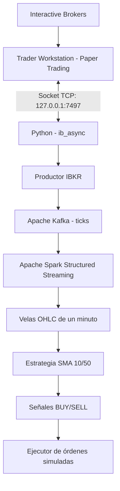

# Integración de la API de Interactive Brokers

**Proyecto:** Trading Algorítmico  
**Programa académico:** Licenciatura en Inteligencia Artificial y Ciencia de Datos  
**Fecha de implementación:** 24 de noviembre de 2026  
**Última actualización:** 27 de noviembre de 2026
**Versión del documento:** 1.2
**Estado:** Cotizaciones EURUSD en tiempo real, integración con Kafka y Spark y ciclo controlado Paper verificados. Corrida de mercado a ejecución aprobada en TWS Paper.

---

## 1. Objetivo

Establecer una conexión entre Interactive Brokers (IBKR) y nuestro proyecto de Trading Algorítmico mediante Python, con el propósito de recibir cotizaciones del mercado FOREX y utilizarlas posteriormente para construir velas OHLC y generar señales de compra y venta.

El proyecto tiene fines exclusivamente educativos.

Todas las pruebas se realizan utilizando una cuenta Paper Trading (negociación simulada), sin operaciones con dinero real.

### 1.1. Objetivos específicos

- Comprender el funcionamiento de una API financiera.
- Configurar una conexión mediante sockets TCP.
- Recibir cotizaciones de EUR/USD.
- Comprender el procesamiento de eventos asíncronos.
- Estandarizar los datos recibidos.
- Preparar su publicación en Apache Kafka.
- Garantizar la reproducibilidad del procedimiento entre los integrantes del equipo.

---

## 2. Fundamentos técnicos

### 2.1. ¿Qué es Interactive Brokers?

Interactive Brokers (IBKR) es un intermediario financiero que proporciona acceso electrónico a diferentes mercados financieros, incluyendo acciones, divisas, futuros y opciones.

En nuestro proyecto se utiliza como fuente de cotizaciones del mercado FOREX.

### 2.2. ¿Qué es una API?

API significa Application Programming Interface (Interfaz de Programación de Aplicaciones).

Es un conjunto de reglas y mecanismos que permite que diferentes sistemas informáticos intercambien información.

En nuestro caso, la API permite que un programa Python solicite y reciba información de Interactive Brokers sin necesidad de introducir manualmente cada solicitud en la interfaz gráfica.

### 2.3. ¿Qué es Trader Workstation?

Trader Workstation (TWS) es una aplicación de escritorio de Interactive Brokers que permite visualizar información financiera y realizar operaciones.

Además, ofrece una interfaz de conexión mediante sockets para aplicaciones externas.

Nuestro programa Python se comunica con TWS, y TWS mantiene la comunicación con la infraestructura de Interactive Brokers.

### 2.4. ¿Qué es Paper Trading?

Es una modalidad de negociación simulada que permite probar estrategias y operaciones sin utilizar dinero real.

Es importante distinguir entre:

- La naturaleza simulada de las operaciones.
- La procedencia y modalidad de las cotizaciones financieras.

Una cuenta simulada puede recibir datos financieros reales o diferidos, dependiendo de sus permisos y condiciones de acceso.

### 2.5. ¿Qué es un socket?

Un socket es un mecanismo de comunicación entre procesos informáticos.

Permite establecer un canal mediante el cual dos aplicaciones intercambian información.

En este proyecto utilizamos un socket TCP para comunicar Python con Trader Workstation.

### 2.6. ¿Qué es TCP?

TCP significa Transmission Control Protocol.

Es un protocolo de transporte que proporciona un flujo de bytes ordenado y confiable entre aplicaciones conectadas.

TCP permite comprobar que existe comunicación entre nuestro programa y TWS, pero una conexión TCP exitosa no garantiza por sí sola que el protocolo de la API funcione correctamente.

Por esa razón se realizaron pruebas independientes de conectividad TCP y de comunicación mediante la API.

### 2.7. ¿Qué es localhost?

Localhost representa la propia computadora desde la cual se ejecuta un programa.

La dirección IPv4 de loopback utilizada en este proyecto es:

    127.0.0.1

Esto significa que Python se conecta a una aplicación que se encuentra ejecutándose en la misma computadora.

No se requiere exponer el puerto de TWS a Internet.

TWS sí necesita conectividad con la infraestructura de IBKR.

### 2.8. ¿Qué es un puerto?

Un puerto identifica un punto lógico de comunicación dentro de un sistema informático.

Los puertos predeterminados habitualmente utilizados por las aplicaciones de IBKR son:

| Aplicación | Cuenta real | Cuenta simulada |
|---|---:|---:|
| Trader Workstation | 7496 | 7497 |
| IB Gateway | 4001 | 4002 |

Estos puertos pueden modificarse mediante la configuración de la aplicación.

Para nuestro proyecto se utiliza:

    127.0.0.1:7497

El puerto no constituye por sí mismo una garantía de que la cuenta sea simulada. También debe verificarse la modalidad de sesión dentro de TWS.

---

## 3. Arquitectura del sistema

La arquitectura prevista del proyecto es:



### 3.1. Separación de responsabilidades

| Componente | Responsabilidad |
|---|---|
| Interactive Brokers | Proporcionar información del mercado. |
| TWS | Administrar la sesión y ofrecer acceso mediante API. |
| Python | Solicitar y procesar cotizaciones. |
| ib_async | Facilitar la comunicación con la TWS API. |
| Kafka | Transportar eventos de cotizaciones. |
| Spark | Procesar eventos y construir velas. |
| SMA 10/50 | Generar señales según las reglas de la estrategia. |
| Ejecutor | Validar riesgos y gestionar órdenes simuladas. |

La conexión con Interactive Brokers es independiente de Kafka, Spark y Docker.

---

## 4. Descarga e instalación de Trader Workstation

### 4.1. Enlace oficial

Página oficial de descarga utilizada:

https://www.interactivebrokers.com/es/trading/download-tws.php?menu=A

Este enlace permite acceder a los instaladores de TWS desde la página pública de Interactive Brokers.

Durante las pruebas se encontraron problemas de redirección al intentar descargar TWS desde el portal de usuario.

La página pública de descarga permitió continuar con la instalación.

### 4.2. Versión recomendada

Seleccionar:

- Versión estable actualizable (Updatable Stable).
- Windows.
- Arquitectura de 64 bits.

Se recomienda la versión estable porque el proyecto requiere un entorno reproducible y no necesita funcionalidades experimentales.

La compilación exacta de TWS instalada durante la prueba no quedó registrada.

### 4.3. Instalación

1. Descargar el instalador.
2. Ejecutar el archivo descargado.
3. Seleccionar una carpeta independiente del repositorio.
4. Completar la instalación.

Ruta de instalación seleccionada:

    C:\Jts

No instalar TWS dentro de la carpeta del proyecto.

TWS es una aplicación independiente y sus archivos no deben formar parte del repositorio de GitHub.

### 4.4. Separación de directorios

    C:\Jts
        Aplicación Trader Workstation

    C:\Users\<usuario>\Desktop\Proyecto_Trading_Algoritmico
        Repositorio del proyecto

    Proyecto_Trading_Algoritmico\venv
        Entorno virtual de Python

La ruta del repositorio puede variar dependiendo de la computadora de cada integrante.

---

## 5. Inicio de sesión en Paper Trading

### 5.1. Procedimiento

1. Abrir Trader Workstation.
2. Seleccionar la modalidad Paper Trading.
3. Introducir las credenciales autorizadas.
4. Iniciar sesión.
5. Confirmar visualmente que TWS indica que se trata de negociación simulada.

No utilizar la modalidad Live Trading para este proyecto.

### 5.2. Conflicto de sesiones

Durante las pruebas, TWS informó que existía otra sesión activa.

Esto impedía visualizar correctamente las cotizaciones.

Procedimiento aplicado:

1. Regresar al navegador.
2. Cerrar la sesión de Interactive Brokers desde el portal.
3. Regresar a TWS.
4. Pulsar Refresh.

Resultado:

Se restableció la visualización de cotizaciones.

Si el problema persiste, comprobar si existe otra sesión iniciada con las mismas credenciales.

---

## 6. Configuración de la API

### 6.1. Ubicación

Dentro de Trader Workstation, ingresar a:

    Archivo
        Configuración global
            API
                Configuración

Los nombres de los menús pueden variar ligeramente dependiendo del idioma y la versión de TWS.

### 6.2. Parámetros

| Configuración | Valor |
|---|---|
| Activar clientes ActiveX y Socket | Activado |
| API solo lectura | Activado |
| Enviar mensajes API en inglés | Activado |
| Socket Port | 7497 |
| Permitir conexiones solo de localhost | Activado |
| Recurso automático a datos diferidos | Activado |

### 6.3. Justificación

**Activar clientes ActiveX y Socket**

Permite que aplicaciones externas utilicen la interfaz de comunicación de TWS.

Sin esta opción, nuestro programa Python no podría conectarse mediante la TWS API.

**API solo lectura**

Restringe las operaciones disponibles desde la API para evitar el envío de órdenes durante esta etapa.

**Mensajes API en inglés**

Facilita la investigación de errores mediante documentación técnica y búsquedas de mensajes originales.

**Puerto 7497**

Corresponde al puerto predeterminado de TWS para Paper Trading.

**Conexiones solo de localhost**

Limita la conexión a aplicaciones que se ejecutan en la misma computadora.

**Datos diferidos**

Permite recurrir a datos diferidos cuando estén disponibles y no se disponga de acceso a datos en tiempo real.

Esta configuración no garantiza que todos los instrumentos financieros tengan cotizaciones disponibles.

### 6.4. Guardar los cambios

Pulsar Aplicar y Aceptar.

Mantener Trader Workstation abierto durante las pruebas de conexión.

---

## 7. Preparación del entorno Python

### 7.1. Ubicación de trabajo

Abrir Git Bash e ingresar a la carpeta local del repositorio.

Ejemplo:

```bash
cd ~/Desktop/Proyecto_Trading_Algoritmico
```

Donde:

- `cd` significa change directory.
- `~` representa la carpeta personal del usuario.
- `Desktop` representa el escritorio.
- `Proyecto_Trading_Algoritmico` es la carpeta del repositorio.

### 7.2. Entorno virtual

Activar el entorno virtual existente:

```bash
source venv/Scripts/activate
```

Si todavía no existe un entorno virtual, crearlo previamente:

```bash
python -m venv venv
```

El indicador `(venv)` debe aparecer en la terminal después de la activación.

Un entorno virtual permite aislar las dependencias del proyecto respecto de otras instalaciones de Python.

Si el entorno virtual de otro integrante se llama `.venv`, deberá utilizar la ruta correspondiente.

### 7.3. Dependencias iniciales

El archivo requirements.txt contenía:

```text
confluent-kafka
pandas
matplotlib
yfinance
```

Estas bibliotecas se conservan como parte del proyecto.

---

## 8. Prueba de conectividad TCP

Antes de instalar una biblioteca especializada, se comprobó que Python podía abrir una conexión con el puerto configurado en TWS.

### 8.1. Comando

Ejecutar en Git Bash:

```bash
python -c "import socket; s = socket.create_connection(('127.0.0.1', 7497), timeout=5); print('Conexion TCP exitosa con TWS'); s.close()"
```

### 8.2. Explicación

| Instrucción | Función |
|---|---|
| python -c | Ejecuta código Python desde la terminal. |
| import socket | Importa la biblioteca estándar de comunicación mediante sockets. |
| socket.create_connection | Intenta establecer una conexión TCP. |
| 127.0.0.1 | Identifica la computadora local. |
| 7497 | Puerto configurado en TWS. |
| timeout=5 | Establece un límite de espera de cinco segundos. |
| s.close() | Cierra la conexión. |

### 8.3. Resultado obtenido

    Conexion TCP exitosa con TWS

### 8.4. Conclusión

La aplicación TWS estaba escuchando en el puerto configurado y Python pudo establecer una conexión TCP.

Todavía era necesario validar el protocolo específico de la API.

---

## 9. Instalación de ib_async

### 9.1. ¿Qué es ib_async?

Es una biblioteca de terceros para Python que facilita la comunicación síncrona y asíncrona con la API de Interactive Brokers.

No debe confundirse con el SDK oficial de Interactive Brokers.

Se seleccionó porque permite trabajar con:

- Conexiones a TWS.
- Contratos financieros.
- Suscripciones a cotizaciones.
- Eventos asíncronos.
- Gestión de conexiones.

### 9.2. Instalación inicial

```bash
python -m pip install ib_async
```

El comando utiliza el administrador de paquetes asociado al intérprete de Python del entorno virtual activo.

### 9.3. Verificación de versión

```bash
python -m pip show ib_async
```

Resultado obtenido:

```text
Name: ib_async
Version: 2.1.0
License: BSD
Requires: aeventkit, nest_asyncio, tzdata
```

La ubicación del paquete confirmó que estaba instalado dentro del entorno virtual del proyecto.

### 9.4. Actualización de requirements.txt

Se agregó la versión comprobada mediante:

```bash
printf '\nib_async==2.1.0\n' >> requirements.txt
```

El operador `>>` agrega contenido al final del archivo sin sobrescribir las dependencias existentes.

Este comando solo debe ejecutarse si la dependencia todavía no está registrada.

Contenido final:

```text
confluent-kafka
pandas
matplotlib
yfinance

ib_async==2.1.0
```

Se conservaron inicialmente las demás dependencias sin fijar sus versiones.

**Actualización del 26/11/2026:** las dependencias directas vigentes son:

- confluent-kafka==2.16.2
- pandas==3.1.1
- matplotlib==3.11.2
- yfinance==1.8.0
- ib_async==2.1.0

Estas versiones están registradas en requirements.txt.
La comprobación local mediante pip check no detectó incompatibilidades.

Para nuevas instalaciones, utilizar requirements.txt y no repetir los comandos históricos de incorporación de dependencias.

### 9.5. Instalación para otros integrantes

Una vez que el archivo requirements.txt actualizado esté disponible en GitHub, los integrantes podrán instalar las dependencias mediante:

```bash
python -m pip install -r requirements.txt
```

La opción `-r` indica que pip debe leer las dependencias desde el archivo especificado.

---

## 10. Prueba de comunicación con la API

### 10.1. Comando

```bash
python -c "from ib_async import IB; ib = IB(); ib.connect('127.0.0.1', 7497, clientId=1, readonly=True, timeout=10); print('API IBKR conectada:', ib.isConnected()); ib.disconnect()"
```

### 10.2. Explicación

| Instrucción | Función |
|---|---|
| from ib_async import IB | Importa la clase principal de conexión. |
| IB() | Crea una instancia del cliente. |
| ib.connect() | Establece la comunicación con TWS. |
| clientId=1 | Identifica al cliente dentro de la sesión API. |
| readonly=True | Indica a la biblioteca que la conexión se utiliza en un contexto de solo lectura. |
| timeout=10 | Establece un límite de espera. |
| ib.isConnected() | Comprueba si la conexión permanece establecida. |
| ib.disconnect() | Finaliza la conexión. |

El parámetro readonly de la biblioteca no sustituye la restricción de solo lectura configurada directamente en TWS.

### 10.3. Resultado obtenido

```text
API IBKR conectada: True
```

### 10.4. Conclusión

Se estableció correctamente la comunicación mediante la TWS API.

La prueba demostró que Python podía comunicarse con Interactive Brokers a través de TWS utilizando ib_async.

---

## 11. Recepción de cotizaciones FOREX

### 11.1. ¿Qué es FOREX?

FOREX es el mercado de intercambio de divisas.

En este proyecto se utiliza el par EUR/USD.

EUR representa el euro y USD representa el dólar estadounidense.

Una cotización de EUR/USD expresa cuántos dólares estadounidenses equivalen a un euro.

### 11.2. Conceptos financieros

**BID**

Precio al que puede venderse la divisa base según la cotización disponible.

**ASK**

Precio al que puede comprarse la divisa base según la cotización disponible.

**Spread**

Diferencia entre ASK y BID.

    spread = ask - bid

**MID**

Precio medio entre BID y ASK.

    mid = (bid + ask) / 2

**Pip**

Unidad convencional de variación del precio.

Para EUR/USD, un pip equivale generalmente a 0.0001.

### 11.3. Solicitud de cotizaciones

```bash
python -c "from ib_async import IB, Forex; ib = IB(); ib.connect('127.0.0.1', 7497, clientId=1, readonly=True); ib.reqMarketDataType(3); contrato = Forex('EURUSD'); ib.qualifyContracts(contrato); ticker = ib.reqMktData(contrato); ib.sleep(15); print('EURUSD | BID:', ticker.bid, '| ASK:', ticker.ask, '| Tipo de datos:', ticker.marketDataType); ib.cancelMktData(contrato); ib.disconnect()"
```

### 11.4. Explicación

| Instrucción | Función |
|---|---|
| Forex('EURUSD') | Define el instrumento financiero. |
| qualifyContracts() | Resuelve y completa la identificación del contrato ante IBKR. |
| reqMarketDataType(3) | Solicita datos diferidos cuando corresponda. |
| reqMktData() | Solicita una suscripción a las cotizaciones. |
| ib.sleep(15) | Permite procesar actualizaciones durante 15 segundos. |
| ticker.bid | Recupera el precio BID. |
| ticker.ask | Recupera el precio ASK. |
| ticker.marketDataType | Consulta el tipo de datos registrado por la biblioteca. |
| cancelMktData() | Cancela la suscripción. |
| disconnect() | Cierra la conexión. |

### 11.5. Resultado registrado

```text
EURUSD | BID: 1.09664 | ASK: 1.09666 | Tipo de datos: 1
```

Cálculos derivados:

    Spread = 1.09666 - 1.09664
    Spread = 0.00002
    Spread = 0.2 pips

    MID = (1.09664 + 1.09666) / 2
    MID = 1.09665

Los valores corresponden a la prueba realizada y no representan una cotización permanente.

### 11.6. Tipos de datos de mercado

| Código | Modalidad |
|---:|---|
| 1 | Live: tiempo real |
| 2 | Frozen: datos congelados |
| 3 | Delayed: datos diferidos |
| 4 | Delayed Frozen: datos diferidos congelados |

Aunque se solicitó el tipo 3, la biblioteca reportó el tipo 1.

Esto es compatible con la posibilidad de recibir datos en tiempo real cuando existen permisos suficientes.

Sin embargo, no se realizó una medición independiente de latencia ni una auditoría de los permisos de mercado.

Por tanto, no debe afirmarse que todos los integrantes recibirán necesariamente datos en tiempo real.

El 27 de noviembre se verificó directamente la notificación de tipo 1 de TWS para EURUSD en la cuenta Paper de prueba. La confirmación identifica la modalidad del dato en esa sesión. [Tipos de datos de mercado de IBKR](https://interactivebrokers.github.io/tws-api/market_data_type.html)

---

## 12. Recepción continua de cotizaciones

### 12.1. Objetivo

Comprobar que la conexión permite procesar múltiples actualizaciones y no solamente recuperar una cotización aislada.

### 12.2. Comando

```bash
python -c "from ib_async import IB, Forex; ib = IB(); ib.connect('127.0.0.1', 7497, clientId=1, readonly=True); ib.reqMarketDataType(3); contrato = Forex('EURUSD'); ib.qualifyContracts(contrato); ticker = ib.reqMktData(contrato); ticker.updateEvent += lambda t: print(t.time, 'BID:', t.bid, 'ASK:', t.ask, 'Tipo:', t.marketDataType); ib.sleep(30); ib.cancelMktData(contrato); ib.disconnect()"
```

### 12.3. Programación orientada a eventos

La programación orientada a eventos permite ejecutar una función cuando ocurre un acontecimiento determinado.

En este caso, el acontecimiento consiste en una actualización del objeto que contiene las cotizaciones.

La expresión:

```python
ticker.updateEvent += lambda t: print(
    t.time,
    "BID:", t.bid,
    "ASK:", t.ask
)
```

Registra una función que se ejecuta cuando se produce una actualización.

La función lambda es una función anónima de Python.

A diferencia de un procedimiento que solicita manualmente cada precio, este mecanismo permite reaccionar a las actualizaciones recibidas.

### 12.4. Registro de resultados

Extracto de resultados registrados durante la sesión:

| Hora UTC | BID | ASK |
|---|---:|---:|
| 21:23:05 | 1.09660 | 1.09662 |
| 21:23:06 | 1.09660 | 1.09661 |
| 21:23:15 | 1.09659 | 1.09661 |
| 21:23:19 | 1.09659 | 1.09661 |

Se observaron actualizaciones sucesivas y cambios de precio.

### 12.5. Conclusión

Se verificó la recepción continua de cotizaciones de EUR/USD mediante la API de Interactive Brokers durante una prueba de 30 segundos.

Esto no equivale a certificar la recepción de todos los ticks individuales del mercado ni la estabilidad del servicio durante periodos prolongados.

---

## 13. Desarrollo del productor de cotizaciones IBKR

### 13.1. Productor existente

El proyecto ya contaba con:

    src/productor_ticks.py

Este programa genera cotizaciones ficticias para comprobar el funcionamiento de la infraestructura Kafka.

Se decidió conservarlo sin modificaciones.

### 13.2. Nuevo productor

Se creó un archivo independiente:

    src/productor_ibkr.py

Comando utilizado:

```bash
touch src/productor_ibkr.py
```

El comando touch crea el archivo si no existe.

Para editarlo se utilizó:

```bash
code src/productor_ibkr.py
```

Este comando abre el archivo en Visual Studio Code.

### 13.3. Justificación de la separación

Conservar dos productores permite:

- Realizar pruebas controladas con datos ficticios.
- Probar cotizaciones procedentes de IBKR.
- Mantener las funcionalidades previamente desarrolladas.
- Identificar errores según la fuente de datos.
- Evitar dependencias innecesarias durante pruebas unitarias.

Ambos productores utilizan el tópico ticks.

No deben ejecutarse simultáneamente sin mecanismos de aislamiento de datos.

También debe verificarse que el consumidor no procese cotizaciones ficticias almacenadas anteriormente en el tópico.

### 13.4. Contrato de datos

El productor IBKR conserva el formato previamente definido para el proyecto:

```json
{
    "symbol": "EURUSD",
    "bid": 1.09659,
    "ask": 1.09661,
    "timestamp": "2026-11-24T21:23:19Z"
}
```

El formato contiene:

| Campo | Tipo | Descripción |
|---|---|---|
| symbol | string | Instrumento financiero. |
| bid | number | Precio comprador. |
| ask | number | Precio vendedor. |
| timestamp | string | Marca temporal UTC. |

El formato del evento es compatible con la estructura establecida por el profesor.

### 13.5. Funciones principales

| Función | Responsabilidad |
|---|---|
| confirmar_entrega() | Recibir el resultado de la publicación en Kafka. |
| procesar_cotizacion() | Validar y preparar las cotizaciones. |
| main() | Coordinar las conexiones y la ejecución. |

### 13.6. Validaciones implementadas

El productor incorpora:

- Validación de valores numéricos finitos.
- Rechazo de precios negativos o iguales a cero.
- Rechazo de cotizaciones donde ASK sea menor que BID.
- Filtrado de cotizaciones consecutivas idénticas.
- Serialización mediante JSON.
- Confirmación de entrega mediante callbacks de Kafka.
- Configuración de idempotencia del productor Kafka.
- Manejo básico de excepciones.
- Cierre de las conexiones al finalizar.
- Interrupción mediante Ctrl+C.

### 13.7. Decisiones técnicas pendientes de revisión

El productor utiliza la hora local de procesamiento convertida a UTC para construir el campo timestamp.

Esta marca temporal no equivale necesariamente a la hora original del evento en el mercado.

Además, se filtran cotizaciones consecutivas idénticas.

Esto puede afectar al campo num_ticks de las velas y debe revisarse conforme a los requisitos del profesor.

La idempotencia del productor Kafka reduce determinados riesgos de duplicación durante reintentos, pero no garantiza por sí sola una entrega exactamente una vez en todo el sistema.

El manejo de errores de publicación y recuperación de conexiones deberá fortalecerse antes de considerar el productor terminado.

---

## 14. Validación de sintaxis

### 14.1. Comando ejecutado

```bash
python -m py_compile src/productor_ibkr.py
```

El módulo py_compile permite compilar el código fuente y detectar errores de sintaxis sin ejecutar el programa.

### 14.2. Resultado

El comando finalizó sin mensajes de error.

### 14.3. Alcance de la validación

Se comprobó que el archivo es sintácticamente válido.

No se comprobó todavía:

- La ejecución completa del productor.
- La publicación de cotizaciones en Kafka.
- La recuperación ante fallos.
- El procesamiento de los eventos por Spark.

Una validación de sintaxis no debe confundirse con una prueba funcional.

---

## 15. Relación con Docker, Kafka y Spark

### 15.1. ¿Es necesario Docker para conectar la API?

No.

La conexión con Interactive Brokers se verificó utilizando únicamente:

- Trader Workstation.
- Python.
- ib_async.
- Una cuenta Paper Trading.
- Conectividad con IBKR.

Docker no intervino en estas pruebas.

### 15.2. ¿Por qué se utiliza Kafka?

Kafka permite transportar eventos entre componentes independientes.

El productor de cotizaciones publica mensajes y los consumidores pueden procesarlos sin tener que conectarse directamente con Interactive Brokers.

### 15.3. ¿Por qué se utiliza Spark?

Spark Structured Streaming permite procesar flujos continuos de datos.

Dentro del proyecto, su función prevista es agrupar las cotizaciones en intervalos de un minuto y calcular velas OHLC.

### 15.4. ¿Qué función tiene Docker?

Docker permite empaquetar y ejecutar aplicaciones mediante contenedores.

Puede utilizarse para ejecutar Kafka y Spark sin instalarlos directamente como aplicaciones independientes en el sistema operativo.

Sin embargo, Kafka y Spark también pueden ejecutarse mediante otras configuraciones.

### 15.5. Alcance de las pruebas iniciales

La computadora utilizada para conectar la API no contaba con Docker instalado.

No se comprobó la disponibilidad de un servicio Kafka local en dicha computadora.

Por tanto, no se ejecutó el nuevo productor integrado.

El 27 de noviembre se validó el productor con Kafka en el entorno integrado y se observaron velas y señales de mercado.

---

## 16. Errores encontrados y soluciones

### 16.1. Redirección repetida al iniciar sesión

**Problema:** la descarga iniciada desde el portal de usuario solicitaba iniciar sesión repetidamente.

**Solución:** utilizar la página pública de descarga de TWS.

### 16.2. Error HTTP 404

**Problema:** una dirección de descarga previamente utilizada no estaba disponible.

**Solución:** utilizar la dirección oficial documentada en la sección 4.

### 16.3. Conflicto entre sesiones

**Problema:** TWS informó que existía otra sesión activa.

**Solución:** cerrar la sesión del navegador y actualizar TWS.

### 16.4. Error bash: command not found

**Problema:** se introdujo código Python directamente en Git Bash.

**Causa:** Bash y Python son intérpretes diferentes.

Bash intentó interpretar instrucciones como import, from y def como comandos propios de la terminal.

**Solución:** abrir el archivo Python en Visual Studio Code, pegar el código dentro del editor y guardar el archivo.

### 16.5. Diferencia entre terminal y editor

| Git Bash | Visual Studio Code |
|---|---|
| Ejecuta comandos. | Permite editar archivos. |
| Administra Git. | Permite escribir código fuente. |
| Inicia programas Python. | Permite guardar programas. |

El código Python puede ejecutarse desde Git Bash mediante el intérprete correspondiente, pero no debe pegarse directamente como si fuera código Bash.

---

## 17. Seguridad y buenas prácticas

Durante esta etapa se establecieron las siguientes medidas:

1. Utilizar exclusivamente Paper Trading.
2. Mantener activada la API de solo lectura.
3. Restringir las conexiones a localhost.
4. No exponer el puerto 7497 a Internet.
5. No almacenar credenciales dentro del código fuente.
6. No publicar contraseñas, números de cuenta ni información personal en GitHub.
7. No incluir el entorno virtual en el repositorio.
8. No contratar servicios de datos sin autorización.
9. Cancelar las suscripciones cuando terminen las pruebas.
10. Cerrar correctamente las conexiones.
11. Utilizar identificadores de cliente distintos si se ejecutan varios clientes API simultáneamente.
12. Verificar las condiciones de uso de los datos antes de compartir archivos que contengan cotizaciones del proveedor.

El acceso a la API no garantiza automáticamente permisos gratuitos para todos los instrumentos financieros.

---

## 18. Estado de las pruebas

| Prueba | Estado |
|---|---|
| Instalación de TWS | Verificada |
| Acceso a Paper Trading | Verificado |
| Configuración de la API | Verificada |
| Conectividad TCP | Verificada |
| Instalación de ib_async 2.1.0 | Verificada |
| Comunicación mediante API | Verificada |
| Recepción de cotizaciones EUR/USD | Verificada |
| Recepción continua durante 30 segundos | Verificada |
| Actualización de requirements.txt | Realizada |
| Creación de productor_ibkr.py | Realizada |
| Validación de sintaxis | Aprobada |
| Ejecución del productor IBKR | Verificada |
| Publicación de cotizaciones en Kafka | Verificada en `ticks_ibkr_prueba` |
| Construcción de velas con datos de IBKR | Verificada en `velas_ibkr_prueba` |
| Integración IBKR con estrategia SMA | SMA 3/5 publicó BUY y SELL con velas de mercado |
| Ejecución de órdenes simuladas | BUY y SELL controlados verificados en TWS Paper |
| Ciclo automático con señales controladas | Aprobado, 0 EUR en TWS y posición cerrada en SQLite |
| Ciclo con señales originadas por la estrategia y ejecutadas en Paper | Aprobado, 0 EUR en TWS y posición cerrada en SQLite |
| Medición independiente de latencia | Pendiente |
| Reproducción en otras computadoras | Pendiente |

---

## 19. Conclusión

La prueba del 27 de noviembre conectó las cotizaciones en tiempo real de IBKR con Kafka, las velas OHLC de Spark y el cálculo SMA 3/5. La estrategia publicó BUY y SELL en un tópico aislado. En una prueba separada, el ejecutor completó y concilió un BUY y un SELL en TWS Paper de forma automática.

La corrida `50c598d3dc` confirmó ambas ejecuciones a partir de señales de mercado de SMA 3/5. TWS quedó con 0 EUR y SQLite con la posición cerrada. Consulta la [bitácora de validación](docs/BITACORA_VALIDACION_2026-11-27.md).

---

## 20. Referencias técnicas

### Interactive Brokers

Descarga oficial de Trader Workstation:

https://www.interactivebrokers.com/es/trading/download-tws.php?menu=A

Documentación de la TWS API:

https://interactivebrokers.github.io/tws-api/

### Python

Documentación de sockets:

https://docs.python.org/3/library/socket.html

Documentación sobre entornos virtuales:

https://docs.python.org/3/library/venv.html

Documentación de py_compile:

https://docs.python.org/3/library/py_compile.html

### ib_async

Repositorio de la biblioteca:

https://github.com/ib-api-reloaded/ib_async

Paquete Python:

https://pypi.org/project/ib-async/

### Apache Kafka

https://kafka.apache.org/documentation/

### Apache Spark

https://spark.apache.org/docs/latest/streaming/index.html

---

## 21. Control de versiones del documento

| Versión | Fecha | Descripción |
|---|---|---|
| 1.0 | 2026-11-24 | Documentación inicial de instalación, configuración, conexión API, recepción de cotizaciones y desarrollo preliminar del productor IBKR. |

| 1.1 | 2026-11-26 | Integracion de controles de seguridad, autorizacion de cuenta Paper y pruebas del ejecutor Dry Run. |
| 1.2 | 2026-11-27 | Datos EURUSD en tiempo real, Kafka, Spark, SMA de mercado y ciclo de órdenes controladas Paper. |

---

## 22. Seguridad del ejecutor Dry Run — 26/11/2026

### 22.1. Componentes implementados

- src/seguridad_ibkr.py: validación de conexión y cuenta autorizada.
- src/ejecutor_riesgo.py: integración de controles de seguridad.
- .env: configuración privada de la cuenta Paper autorizada.

### 22.2. Controles implementados

- Conexión local mediante 127.0.0.1:7497.
- Client ID 31.
- Conexión mediante readonly=True.
- Validación de identificadores Paper DU y DUR.
- Comparación exacta con la cuenta autorizada en .env.
- Validación previa al inicio de Kafka y SQLite.
- Comprobación de conexión durante el consumo de señales.
- Bloqueo ante desconexión detectada.
- Cierre de conexión durante la finalización normal.

### 22.3. Evidencias de pruebas

| Prueba | Resultado |
|---|---|
| Cuenta Paper autorizada | Aprobada |
| Rechazo de cuenta no autorizada | Aprobada en el módulo de validación |
| Inicio del ejecutor con TWS activo | Aprobada |
| Detención mediante Ctrl+C | Aprobada |
| Cierre de TWS durante la ejecución | Bloqueo correcto |
| Inicio con TWS cerrado | Bloqueo correcto |
| Consumo integrado de Kafka | No comprobado |
| Envío de órdenes | No realizado |

### 22.4. Limitaciones

Kafka no estuvo disponible en el equipo utilizado durante
estas pruebas.

La detección de desconexión no garantiza identificar
inmediatamente todas las interrupciones silenciosas de red.

En el corte del 26/11 el ejecutor estaba en Dry Run y la API en solo lectura.


### 22.5. Continuación del corte histórico

Las actividades de sincronización y validación Dry Run de este corte se completaron el 27/11. El estado vigente figura en la sección siguiente.

## 23. Ejecución y conciliación en Paper

El ejecutor mantiene Dry Run como modo predeterminado. La ejecución Paper requiere `--paper`, un tópico Paper autorizado, la cuenta local configurada en `.env` y permiso de órdenes en la sesión simulada de TWS. Cuando TWS tiene activa la opción **Read-Only API**, la previsualización puede devolver el error 321. [Configuración de la API de TWS](https://interactivebrokers.github.io/tws-api/initial_setup.html)

El ejecutor guarda la intención antes de enviar cada orden límite IOC. Después confirma el llenado completo y consulta el saldo de efectivo EUR. En la prueba, una consulta de posición por contrato devolvió 0 aunque TWS ya había comprado EUR. El saldo de divisas y la ejecución por referencia permitieron conciliarlo. El ajuste final espera de forma acotada que TWS actualice su lista de órdenes y el efectivo. [Saldos por divisa en TWS](https://www.interactivebrokers.com/support/faq/content/see-actual-cash-balances-tws-118722609)

En el ciclo controlado automático se compraron 914 EUR a 1.09380 y se vendieron 914 EUR a 1.09350. El resultado final fue 0 EUR en TWS y posición cerrada en SQLite. El aviso de lote pequeño fue informativo en esa corrida. [Lotes pequeños en IBKR](https://www.interactivebrokers.com/support/faq/content/odd-lot-fx-transactions-1163260635)
